<picture>
  <source media="(prefers-color-scheme: dark)" srcset="./assets/banner-dark.svg">
  
</picture>

Third-year B.Tech CSE student.

### Now

[**Aran**](https://github.com/itzz-inbathamizhanS/Aran), a data-flow firewall that keeps Aadhaar, PAN, UPI IDs and OTPs out of logs, vendors and AI tools. [Live console](https://aran-console.vercel.app)

### Work

<a href="https://github.com/itzz-inbathamizhanS/Q-CAPS"><picture><source media="(prefers-color-scheme: dark)" srcset="./assets/work/q-caps-dark.svg"></picture></a>
<a href="https://github.com/itzz-inbathamizhanS/dhriti"><picture><source media="(prefers-color-scheme: dark)" srcset="./assets/work/dhriti-dark.svg"></picture></a>
<a href="https://github.com/itzz-inbathamizhanS/HybridDFIR"><picture><source media="(prefers-color-scheme: dark)" srcset="./assets/work/hybrid-dfir-dark.svg"></picture></a>
<a href="https://github.com/itzz-inbathamizhanS/QLure"><picture><source media="(prefers-color-scheme: dark)" srcset="./assets/work/q-lure-dark.svg"></picture></a>
<a href="https://github.com/itzz-inbathamizhanS/kavach"><picture><source media="(prefers-color-scheme: dark)" srcset="./assets/work/kavach-dark.svg"></picture></a>
<a href="https://github.com/itzz-inbathamizhanS/zero-trust-smart-campus-ns3"><picture><source media="(prefers-color-scheme: dark)" srcset="./assets/work/zero-trust-campus-dark.svg"></picture></a>
<a href="https://github.com/itzz-inbathamizhanS/the-amazing-web"><picture><source media="(prefers-color-scheme: dark)" srcset="./assets/work/the-amazing-web-dark.svg"></picture></a>
<a href="https://github.com/itzz-inbathamizhanS/Aran"><picture><source media="(prefers-color-scheme: dark)" srcset="./assets/work/aran-dark.svg"></picture></a>

Also: [IterEV](https://github.com/itzz-inbathamizhanS/IterEV), EV routing that weighs future battery risk. [Mugamoodi](https://github.com/itzz-inbathamizhanS/Mugamoodi), a local multiplayer party game.

### Experience

- **Cybersecurity Engineer Intern**, RGreen Technologies · May to Jul 2026. Helped implement ISO/IEC 27001 for an e-commerce platform: ISMS, risk assessment, security governance.
- **Technical Supporter**, KARE ACM-W · Jun 2025 to May 2026.

### Certifications

(ISC)² Certified in Cybersecurity (CC) · Palo Alto Networks Certified Cybersecurity Apprentice · Google IT Support · IBM Java Developer · MongoDB Java Developer Path

### Toolbox

<picture>
  <source media="(prefers-color-scheme: dark)" srcset="./assets/toolbox/toolbox-dark.png">
  
</picture>

Also Render and NS-3.

### Elsewhere

[LinkedIn](https://www.linkedin.com/in/inbathamizhans) · [itzz.inba05@gmail.com](mailto:itzz.inba05@gmail.com)

---

<i>If it is meant to be, it will happen ❤️✨!!!</i>

